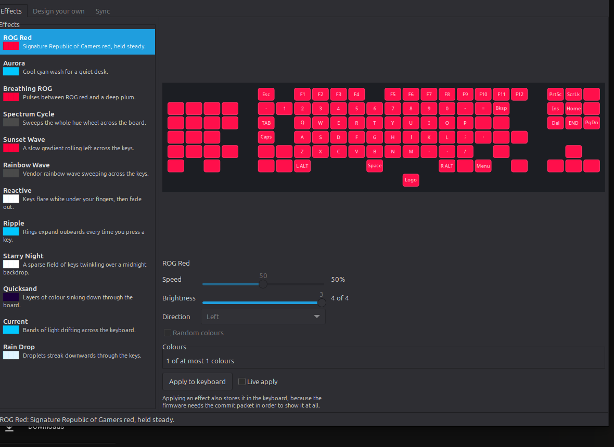

# rog-claymore-linux

Control the RGB lighting of an **ASUS ROG Claymore** keyboard on Linux, without
Armoury Crate and without Windows.

Two programs are built:

* **`claymore`** — a command line tool: firmware effects, per-key painting,
  ASCII preview and the sync daemon.
* **`claymore-gui`** — a GTK 3 application with a live keyboard preview, an
  effect gallery, a per-key design mode and a sync server panel.



There is no ASUS software for Linux, so this talks to the keyboard's own USB HID
protocol directly. See [`docs/PROTOCOL.md`](docs/PROTOCOL.md) for the packet
reference and where it came from.

## What works

* **Firmware effects** — static, breathing, spectrum cycle, reactive, wave,
  ripple, starry night, quicksand, current, rain drop. These run on the keyboard
  itself, so the lighting animates with no host CPU cost and can be saved to
  flash to survive a reboot.
* **Direction, speed and colour** control per effect, plus random colour modes
  where the firmware supports it.
* **Per-key painting** in direct mode: any layout of yours streamed from the PC
  at up to 30 frames per second, and left on the keyboard when the program
  exits - the board keeps the last frame it is given, so a design does not need
  a process to stay lit (see [Making a design stay on the
  keyboard](#making-a-design-stay-on-the-keyboard)).
* **Named designs** you can save, reload, delete and mark as the one to load
  every time the GUI starts, or at login via a systemd user unit.
* **A panel icon** so the window can be put away while the design stays applied,
  with a menu to bring the window back, re-apply the design, or hand the
  keyboard to its firmware.
* **A sync server** so several programs — or your own scripts — can share the
  keyboard, which is the closest thing to Aura Sync on Linux.
* **Layout handling** for both legend sets and for the detachable numpad on
  either side, including auto detection.

## What is honestly not finished

* Verified against **one** keyboard, the author's own ANSI unit. The protocol is
  a re-implementation of a documented reverse engineering effort, and the parts
  that can be checked without hardware are unit tested, but exotic firmware
  revisions may behave differently.
* The four step **brightness** control is an extrapolation from an
  undocumented byte and is labelled experimental in the interface.
* The Claymore's **key press events** are not exposed; the reactive and ripple
  effects are driven by the firmware and their software previews are
  approximations rather than reads of the real thing, because the keyboard
  cannot report its LED colours back.
* Per-key **animations** are not exposed in the GUI yet, only static designs.
* A design **cannot be stored in the keyboard**, only re-applied at login by the
  systemd unit in `contrib/`. The flash has no room for a per key picture: that
  is a hardware limit, not a missing feature.
* Verified end to end against one keyboard: firmware `01.09.01`, numpad mounted
  left, ISO legends. `info`, `keys`, `static`, `breathing`, `paint` and
  `release` were all confirmed working on real hardware, and the detected key
  map was confirmed correct.

## Requirements

* Linux with `hidraw` support and a C++17 compiler.
* GTK 3 development headers for the GUI. Everything else builds without them.
* `python3` only if you want to regenerate the layout tables, or to run the
  GUI checks. Those also want `wmctrl` and ImageMagick, because they drive the
  real window and read real pixels.

No dependency on `hidapi`, `libusb` or `libudev`: the driver reads `/sys` and
writes `/dev/hidraw*` itself. See `src/hidraw.cpp`.

## Build

```sh
make            # CLI + GUI + tests
make cli        # just bin/claymore
make gui        # just bin/claymore-gui
make test       # hardware free test suite
```

## Installing

```sh
sudo make install              # into /usr/local
PREFIX=$HOME/.local make install   # or without root
sudo make uninstall            # your designs in ~/.config/claymore are left alone
make package                   # a .deb, built with dpkg-deb alone
```

`make install` puts the two binaries, the man pages, the desktop entry, the
udev rule, the systemd user unit and the icon where they belong. It will tell
you if GTK 3 was missing, because then there is no GUI and no icons.

`make package` builds `build/rog-claymore_<version>_<arch>.deb` out of exactly
what `make install` stages, so the two can never install different things. It
needs no `debhelper` and no `dh_make`, and the package's `postinst` reloads the
udev rules so the keyboard works without a replug:

```sh
sudo apt install ./build/rog-claymore_1.0.0_amd64.deb
```

Both are checked by `make verify-install`, which stages an install, runs the
staged binaries, validates the desktop entry, checks that every icon is really a
PNG of the size it claims, compares the vector icon against the drawn one, and
asserts that the package contains the same files and that `uninstall` leaves
nothing behind.

The icon is one drawing with two descriptions. At run time `gui/icon.cpp` draws
it with cairo, so the window, the task bar and the panel icon are always the
same picture; `claymore-gui --export-icons <dir>` writes the PNG sizes that
`make install` puts in the icon theme, using that same drawing and needing no
display. `assets/rog-claymore.svg` is the same geometry as vectors for the
launcher, and `verify-install` fails if the two ever disagree.

## Permissions

Reading and writing the keyboard needs access to `/dev/hidraw6` (the Aura control
interface). `sudo make install` installs the udev rule for you; by hand it is:

```sh
sudo cp udev/99-rog-claymore.rules /etc/udev/rules.d/
sudo udevadm control --reload-rules
sudo udevadm trigger
```

Then replug the keyboard, or log out and back in. This grants the `plugdev`
group access; adjust the `GROUP=` in the rule if your distribution uses
something else.

Without the rule, `claymore list` still works (it only reads), but everything
that changes the lighting will report a permission error.

## Command line

```sh
claymore list                    # what hidraw nodes exist, and which is the Claymore
claymore info                    # firmware, numpad side, legend set, active layout
claymore keys                    # every key: frame slot, device LED index, name
claymore layout                  # ASCII map of the matrix

claymore static rog-red          # one solid colour
claymore off                     # black
claymore effect breathing --color ff003c --color 140024 --speed 45
claymore effect wave --color ff003c --color 00c8ff --direction left --speed 40
claymore effect color-cycle --speed 60
claymore preset rainbow-wave

claymore paint --all 300000 --key escape=00ff00 --key numpad-lock=ff00ff
claymore paint --design claymore-design.txt
claymore release                 # hand the keyboard back to its firmware
claymore reset                   # release, then apply a firmware effect

claymore preview wave            # animate an effect in the terminal
claymore preview quicksand --speed 30

claymore designs                 # saved designs, marking the startup one
claymore default Desk            # apply 'Desk' at login, or 'none'
claymore settings                # the preferences shared with the GUI
claymore settings start-in-tray on
```

**Every effect change is stored in the keyboard.** The Claymore will not display
an effect until it has been committed with the `0x50/0x55` packet, and that same
packet is what writes flash. There is no way to preview an effect without also
storing it, so `--no-save` exists only for compatibility and now prints a note
that it is ignored. This is documented properly in `docs/PROTOCOL.md`.

Each effect defaults to the speed the vendor software ships for it, so
`claymore effect wave --color ff0000 --color 0000ff` looks right without any
tuning. Note that the 0..100 speed scale is linear in the firmware's byte and
0 is the *fastest*, so the top of the range is genuinely extreme.

Key names come from the layout, so `claymore keys` is the reference for what you
can pass to `--key`. Slugs (`left-shift`, `f5`) and raw device LED values
(`0x45`) both work.

### Direct mode, and why `paint` exists

Firmware effects are animated by the keyboard. Direct mode is the opposite: the
host takes responsibility for every LED. Granting direct mode pauses the
firmware, so the board shows only what the host sends it.

That has a consequence worth knowing before you script anything. **Entering
direct mode clears the board.** Each `claymore` invocation is a new process that
grants direct mode from scratch, so this

```sh
claymore fill 300000        # board goes dim red
claymore set escape 00ff00   # this blanks the board, then lights Escape
```

leaves you with a single lit key, not a red board with a green Escape. Use one
invocation, which composes a single frame:

```sh
claymore paint --all 300000 --key escape=00ff00
```

If a direct mode session ever leaves the board dark, the fix is one command:

```sh
claymore release
```

`set` and `fill` still exist and still work, they just warn that they repaint the
whole board. `syncd` releases remote control when it exits, so it cannot leave
you in the dark.

### Making a design stay on the keyboard

A painted design is not an effect, and that distinction decides everything about
how long it lasts.

**The keyboard's own memory cannot hold one.** Its flash stores its built in
effects, parameterised by a handful of colours - the `0x50/0x55` commit packet
that stores an effect has no counterpart for a per key picture. OpenRGB is
explicit about this: its `DeviceSaveMode` is marked "not available for
Claymore". This is not a gap in this project; it is how the hardware works, and
it is why Aura Creator on Windows needs its own service running to light per key
layouts.

**But the board does keep the last frame it is given.** So a design needs no
process at all to stay lit:

* `claymore paint --design ~/.config/claymore/design.txt` puts a design on the
  board and deliberately does *not* revoke remote control. The keyboard keeps
  showing it after the command exits.
* The GUI does the same on exit whenever a design is on the keyboard, and saves
  the design to the file above on the way out. Closing the window no longer
  throws the design away.
* `claymore release` hands the keyboard back to its own effects, and unticking
  *Show on keyboard* in the GUI does the same thing.

The trade is that a keyboard holding a design is in remote control: its own
effects (including the Fn key lighting modes) are paused until you release it.
Applying any effect from the *Effects* tab, or the `effect` command, takes the
board back too, so nothing can get permanently stuck.

**Across a reboot** the design has to be re-applied, because the frame lives in
RAM. `contrib/claymore-design.service` is a systemd user unit that does exactly
that:

```sh
mkdir -p ~/.config/systemd/user ~/.local/bin
cp contrib/claymore-design.service ~/.config/systemd/user/
# edit ExecStart in that file if claymore is not in ~/.local/bin
systemctl --user enable --now claymore-design.service
```

It is a one shot, not a daemon: it runs `claymore paint --default`, which loads
whichever design you marked as the startup one, retrying for up to 30 seconds
while the hidraw node appears, and then exits. Nothing stays running, and the
lighting does not depend on this project being resident. Change a design in the
GUI, and the unit picks up the new one at the next login.

The same design is what the GUI loads when it starts, so the two agree by
construction rather than by two files that have to be kept in step:

```sh
claymore designs              # what you have, and which one starts
claymore default Desk         # choose one, or 'none' to clear it
claymore paint --default      # what the unit runs
```

### Terminal preview

`claymore preview <effect>` renders the effect with true colour ANSI blocks
using the same software renderer the GUI uses. It needs no keyboard attached,
which makes it the quickest way to see what an effect will look like.

## Sync daemon

This is the Aura Sync equivalent. It holds the keyboard in direct mode and any
process can push frames to it over a UNIX datagram socket.

```sh
claymore syncd --fps 30
```

```
claymore: streaming frames on /run/user/1000/rog-claymore.sock (88 slots, 30 fps)
```

Options:

| Option | Meaning |
| --- | --- |
| `--socket <path>` | socket to listen on, default `$XDG_RUNTIME_DIR/rog-claymore.sock` |
| `--fps <n>` | frames per second, default 30 |
| `--demo` | skip the socket and animate a rainbow internally |
| `--stdin` | read frames from stdin, one hex or `RGBC` message per line |
| `--idle-effect <name>` | firmware effect to restore when senders go quiet |
| `--idle-timeout <ms>` | how long without frames before restoring it, default 1500 |

The wire format is documented in `docs/PROTOCOL.md`. A minimal client:

```python
import os, socket

KEY_COUNT = 88
sock = socket.socket(socket.AF_UNIX, socket.SOCK_DGRAM)
path = os.environ.get("XDG_RUNTIME_DIR", "/tmp") + "/rog-claymore.sock"

frame = b"RGBC" + bytes([1, 0, KEY_COUNT & 0xFF, KEY_COUNT >> 8])
frame += bytes([0xFF, 0x00, 0x3C] * KEY_COUNT)
sock.sendto(frame, path)
```

Sparse updates only need the keys that changed: set the sparse flag and send
`slot, r, g, b` entries. Sending a `release` message hands the keyboard back to
its firmware.

Without a running daemon, `claymore syncd --demo` is a good way to confirm the
direct mode pipeline works.

## GUI

```sh
claymore-gui
```

Three tabs:

* **Effects** — the preset gallery on the left, an animated preview of the
  keyboard above the controls. Speed, brightness, direction, random colours and
  the colour swatches all apply to the selected effect. *Live apply* pushes
  changes as you drag. There is no "don't save" option, because the commit
  packet is what makes the effect appear at all.
* **Design your own** — paint individual keys with the brush, use the eyedropper
  to copy a key's colour, middle click to erase, or use *Rainbow fill* to get a
  starting point. Designs are saved under a name in
  `~/.config/claymore/designs/`, and the picker on the tab loads, saves,
  deletes and switches between them. *Load at startup* marks one to be loaded
every time the GUI starts — and it is the same one `claymore paint --default`
  applies at login.

  Each design is a plain text file, one `slot colour` per line, so designs are
  diffable, hand editable and scriptable.

  Your first edit shows the design on the keyboard by itself, so painting a key
  lights that key - and it **stays there when you close the window**, because
  the keyboard keeps the last frame it is given. Streamed frames are kept out of
  the way until that first edit: holding the keyboard in direct mode pauses the
  firmware effect, and claiming the board the moment the tab opens would make
  the *Effects* tab look broken. Untick *Show on keyboard* to hand the board
  back, and see [Making a design stay on the keyboard](#making-a-design-stay-on-the-keyboard)
  for surviving a reboot.

  The canvas answers for itself as you switch tools: its title changes from
  *Click or drag to paint* to *Click or drag to erase* to *Click a key to copy
  its colour*, because the eyedropper deliberately does not paint and used to
  look like a canvas that ignored clicks.
* **Sync** — start and stop the sync server and watch incoming colours appear.

The window carries the ROG eye emblem as its icon, drawn with cairo at runtime
rather than loaded from a file, so the title bar, the task list and the panel
icon are all the same drawing and nothing has to be installed for it to work.
`assets/rog-claymore.svg` is the same emblem as vectors for the launcher, and
`make install` also puts PNGs of it in the icon theme; see
`contrib/org.claymore.linux.desktop`.

### Putting the window away

*To panel* in the header hides the window and leaves a ROG icon in the panel,
with the program still running. That matters for two reasons: the design stays
applied, and anything that needs to keep ticking — a preview, or a design with
movement in it — keeps ticking.

The icon's menu offers *Show the window*, *Re-apply my design* (useful after
something else on the machine grabbed the lighting), *Hand the keyboard back*,
and *Quit and keep the design*.

### Starting in the panel

*Start in the panel* in the header (or `claymore settings start-in-tray on`)
saves the choice, so from then on the window stays away on every start and only
the panel icon appears. That is the setting to turn on **before** adding the
program to your desktop's autostart, and it is why the autostart entry needs no
arguments at all:

```sh
claymore settings start-in-tray on
install -Dm644 contrib/autostart/org.claymore.linux.desktop \
    ~/.config/autostart/org.claymore.linux.desktop
```

The design applied at login is the one marked *Load at startup*, so the whole
arrangement is a setting and a file, with no flag to keep in sync.

```sh
claymore-gui --tray        # hide the window for this run, whatever the setting says
claymore-gui --window      # show it for this run even though the setting is on
claymore-gui --no-design   # ignore the startup design for this run
claymore settings          # list the preferences, and where they live
```

`make install` deliberately does not install the autostart file: starting a
program at everybody's login is the user's decision, not the package's. The
systemd unit is the other option, for a design applied at login with nothing
left running at all.

If the desktop has no tray at all (GNOME without an extension, for instance),
the window stays open and says so, rather than leaving a running program that
cannot be seen or reached.

The previews are software renderings of the effects; the keyboard does the real
animating for firmware effects. That distinction matters for the reactive and
ripple effects, whose previews are approximations.

## Effects

| Name | Firmware mode | Colours | Notes |
| --- | --- | --- | --- |
| `static` | 0 | 1 | |
| `breathing` | 1 | 1-2 | pulses between two colours |
| `color-cycle` | 2 | 0 | sweeps the hue wheel |
| `reactive` | 3 | 1-2 | keys flare under your fingers, random colours supported |
| `wave` | 4 | 0-7 | 0 colours means the firmware rainbow wave; with colours the firmware gets the pattern bit automatically |
| `ripple` | 5 | 1-8 | rings expand from each key press |
| `starry-night` | 6 | 1-3 | sparse twinkling |
| `quicksand` | 7 | 6 | exactly six colours, sent in a separate packet |
| `current` | 8 | 1-3 | drifting bands |
| `rain-drop` | 9 | 1-3 | droplets falling down |

Speed runs 0-100 in the interface and is converted to the firmware's 0-254 range,
where a higher firmware value is slower.

## Layouts

The keyboard does not reliably report which legends it has, so the tool infers it
from the USB `bcdDevice` version and the numpad position from the keyboard
itself. Both can be overridden:

```sh
claymore info --region uk       # force ISO key legends
claymore keys --region us
claymore info --numpad left
claymore layout --layout numpad-left-uk
claymore layout --list          # all six variants
```

If `claymore info` reports the wrong legend set, pass `--region` to the command
you are running. Only key names are affected, not which LED lights up.

## Troubleshooting

**"no hidraw device matching 0b05:184d"** — the keyboard is not plugged in, or
`/sys` is unavailable in a container. Check `claymore list`.

**"Permission denied"** — the udev rule is not installed. See Permissions above.

**`claymore info` reports the wrong key legends** — override with `--region`.

**Effects do not survive a reboot** — pass `--persist`, or tick *Save to flash*
in the GUI. Saving is off by default in the GUI because the Claymore rewrites
flash on every save.

**Direct mode leaves the keyboard stuck** — unplug and replug, or send a release
message so the firmware effect resumes.

## Development checks

```sh
make test           # hardware-free checks: packets, layouts, canvas geometry,
                    #   design files, the design store, the settings file
make verify-gui     # launches the GUI, photographs it, checks it painted
make verify-design  # drives the design tab with real clicks, saves a design,
                    #   restarts, and checks the panel icon keeps the design
make verify-install # stages an install, runs what it staged, builds the .deb
                    #   and checks it holds exactly the same files
```

Two things here cannot be reached by unit tests, and both have shipped broken
during development:

* a window that opens and shows nothing, because a canvas was built before the
  layout was known — `verify-gui` photographs the window and counts key pixels.
* a design tab that ignores clicks — `verify-design` clicks *Fill all*, sets the
  brush to white through the real colour dialog, types a name into the real
  "Save as" dialog, clicks keys, and counts the new white pixels.

It then goes further, because the features that matter most here are the ones
that span processes: it closes the window and checks the design stayed on the
keyboard, that the CLI can apply the same design (which is what the systemd unit
runs), that restarting brings the design back with its white keys intact, and
that *To panel* hides the window while the program keeps running. The last step
ticks *Start in the panel*, restarts with no arguments at all — which is what an
autostart entry does — and asserts there is no window on screen, then that
`--window` still gets one back. Every step drives the real window and reads real
pixels or real files.

Neither is a unit test: they drive the running window through X11 and AT-SPI.
`tools/gui_probe.py` is the piece that makes that possible — GTK publishes every
widget over the accessibility bus with its screen coordinates, so a test can
find the button labelled *Fill all* and click it instead of guessing at pixels.
The captures are left in `build/` so you can look at them yourself.

The canvas arithmetic itself (which key is under a click, and how close a click
has to be) lives in `layout.cpp` rather than the GUI, precisely so that it *can*
be unit tested; see the `canvas geometry` checks.

Set `CLAYMORE_GUI_TRACE=1` to have the GUI report every click, key lookup and
design write to stderr. That is how a silent no-op gets a name.

## Regenerating the layout tables

`src/layout_data.cpp` is generated, not hand written:

```sh
python3 tools/gen_layout.py <openrgb>/Controllers/AsusAuraUSBController/\
AsusAuraTUFKeyboardController/AsusAuraTUFKeyboardLayouts.h > src/layout_data.cpp
```

The generator asserts that every matrix cell references a real key, that no two
keys share an LED and that the name counts match the declared LED counts, so a
bad extraction fails loudly instead of producing a subtly wrong driver.

## Licence and attribution

GPL-2.0-or-later. See [`LICENSE`](LICENSE).

The protocol and the per-key LED tables are derived from
[OpenRGB](https://openrgb.org/), specifically
`Controllers/AsusAuraUSBController/AsusAuraTUFKeyboardController/`, authored by
Mola19 and licensed GPL-2.0-or-later. Because this project builds on that work it
is licensed the same way, and the derivation is recorded in
`src/layout_data.cpp`, `include/claymore/protocol.hpp` and
`docs/PROTOCOL.md`.
